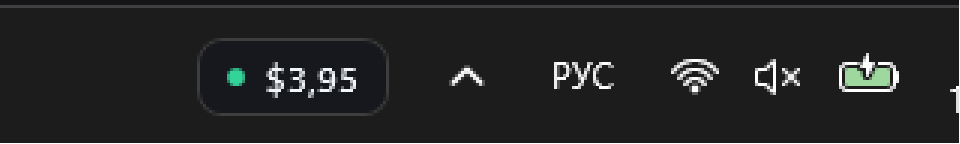

# Баланс Bybit на панели задач

[](https://github.com/itkrasikov-bit/bybit-taskbar-balance/actions/workflows/build.yml)

Маленький чип, который живёт прямо на панели задач Windows 11 (рядом с треем)
и показывает баланс аккаунта Bybit. Обновляется сам, не мешает работе и не лезет
в системный трей иконкой.



## Возможности

- **Баланс на панели задач** — компактная «таблетка» вплотную к трею: `$12 483,57`,
  для крупных сумм — `$1,23M`. Не окно, не иконка в трее, а именно панель задач.
- **Цветной индикатор состояния** — зелёный (всё ок), оранжевый (нет ключа),
  синий (загрузка), красный (ошибка).
- **Клик** — карточка с деталями: капитал, баланс кошелька, доступно,
  нереализованный PnL и разбивка по монетам.
- **Правый клик** — меню: обновить, настройки, открыть Bybit, вернуть к трею, выход.
- **Перетаскивание** — чип можно перенести куда угодно; при отпускании над панелью
  задач он «прилипает» к ней. Позиция запоминается.
- **Самовосстановление** — если панель задач перекрыла чип (бывает после кликов по ней),
  чип возвращается наверх в течение секунды.
- **Не мешает** — не появляется в Alt+Tab, не забирает фокус, скрывается в полноэкранных
  играх и видео.
- **Один экземпляр** — повторный запуск ярлыка просто показывает уже работающий чип.
- Поддержка **нескольких доменов Bybit** (если регион блокирует основной):
  `api.bybit.com`, `api.bybit.nl`, `api.bybitgeorgia.ge`.

## Требования

- Windows 10/11 x64
- [.NET 9 Desktop Runtime](https://dotnet.microsoft.com/download/dotnet/9.0) (если не установлен)

## Установка

1. Скачайте `BybitTaskbar-<версия>.zip` из раздела [Releases](../../releases)
   (или соберите сами, см. ниже).
2. Распакуйте в любую папку, например `C:\Tools\BybitTaskbar`.
3. Запустите `BybitTaskbar.exe` — откроется окно настроек.

При первом запуске программа попросит API-ключ: без него она ничего не показывает.

### Как получить API-ключ (только чтение)

1. bybit.com → аватар → **API** (или <https://www.bybit.com/app/user/api-management>).
2. **Create New Key → System-generated API Keys**.
3. Права: **Read-Only**, включить чтение **Unified Trading → Account**
   (для спота — Wallet/Account).
4. Скопировать **API Key** и **API Secret**, вставить в настройки → **Проверить связь** → **Сохранить**.

Права на торговлю и вывод **не нужны** — не выдавайте их. Ключ можно ограничить по IP.

## Управление

| Действие | Что делает |
|---|---|
| Левый клик по чипу | Карточка: капитал, кошелёк, доступно, нереализованный PnL, монеты |
| Перетаскивание | Двигает чип; над панелью задач — прилипает к ней |
| Правый клик | Меню: детали, обновить, настройки, открыть Bybit, вернуть к трею, скрыть, выход |
| Повторный запуск exe | Показывает уже запущенный чип (вторая копия не создаётся) |

## Настройки

- **Адрес API** — по умолчанию `https://api.bybit.com`.
- **Тип счёта** — `UNIFIED` (единый торговый), `SPOT`, `CONTRACT`.
- **Что показывать** — капитал (equity), баланс кошелька или доступную сумму.
- **Обновление** — от 15 секунд до 15 минут.
- **Скрывать в полноэкранном режиме**.
- **Запускать с Windows** — автозапуск через `HKCU\Software\Microsoft\Windows\CurrentVersion\Run`.
- **Показывать монеты** — список монет в карточке.

## Приватность и безопасность

- Приложение обращается **только** к выбранному домену Bybit. Никакой телеметрии,
  аналитики и сторонних серверов.
- API-секрет **не хранится в открытом виде**: он шифруется через Windows DPAPI —
  расшифровать может только тот же пользователь на той же машине.
- Настройки лежат в `%APPDATA%\BybitTaskbar\config.json`, лог ошибок — рядом в `log.txt`.
- Ключ используется только для чтения баланса (`GET /v5/account/wallet-balance`).

## Если показывает «ошибка» или «нет связи»

| Что видно | Причина |
|---|---|
| `ключ недействителен (HTTP 401)` | Ключ неверный или создан для другого домена |
| `10003` | Неверный API-ключ |
| `10004` | Неверная подпись — проверьте секрет и часы Windows |
| `10005` | У ключа нет права чтения аккаунта |
| `33004` | Истёк срок действия ключа |
| `нет связи` | Нет интернета, блокировка домена, VPN/прокси |

Полный текст ошибки — в карточке (клик по чипу) и в `log.txt`.

## Сборка из исходников

Нужен .NET SDK 9.0.

```powershell
git clone https://github.com/itkrasikov-bit/bybit-taskbar-balance.git
cd bybit-taskbar-balance

dotnet build -c Release
dotnet run -c Release -- --demo        # интерфейс с фейковыми данными, без ключей

dotnet publish -c Release -r win-x64 --self-contained false -o publish
```

Готовые файлы появятся в `publish\` (около 0,3 МБ, framework-dependent).

### Структура

```
BybitTaskbar.csproj      WPF, net9.0-windows, без NuGet-зависимостей
app.manifest             Per-Monitor V2 DPI
App.xaml(.cs)            стили, единственный экземпляр, активация вторым запуском
MainWindow.xaml(.cs)     чип на панели задач, карточка, меню, позиционирование
SettingsWindow.xaml(.cs) окно настроек, проверка связи
Core/
  BybitClient.cs         Bybit v5 wallet-balance, HMAC-SHA256, синхронизация часов
  AppConfig.cs           настройки + DPAPI-секрет
  Dpapi.cs               CryptProtectData без NuGet
  TaskbarGeometry.cs     поиск панели задач/трея, полноэкранный режим, перекрытие
  Interop.cs             Win32
  Fmt.cs                 форматирование сумм (ru-RU)
  StartupReg.cs          автозапуск
  AppLog.cs              лог
```

## Лицензия

[MIT](LICENSE)

---

## English (short)

**Bybit Balance on Taskbar** — a tiny always-on-top chip that sits on the Windows 11
taskbar next to the clock and shows your Bybit account balance.

- Read-only Bybit v5 API (`wallet-balance`), no trading/withdraw permissions needed.
- The API secret is encrypted with Windows DPAPI, stored in `%APPDATA%\BybitTaskbar`.
- No telemetry, no third-party servers: only your Bybit endpoint is contacted.
- Click for details (equity, wallet, available, unrealized PnL, coins), right-click for menu.
- Requires .NET 9 Desktop Runtime. Build with `dotnet publish -c Release -r win-x64 --self-contained false -o publish`.

MIT licensed.
